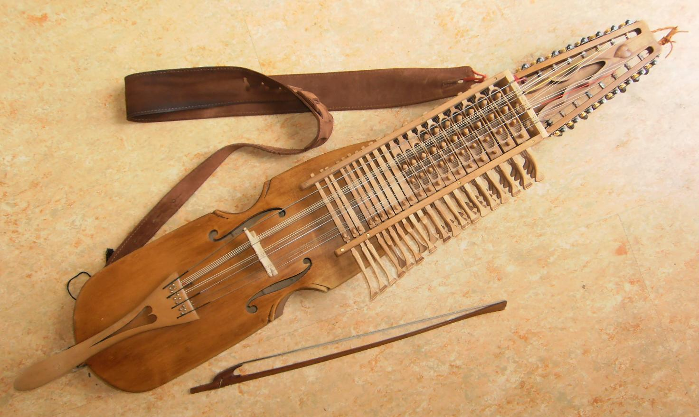

# nyckelharpa

## Setup
1. Install [`nix`](https://docs.determinate.systems/)

2. Clone the repository
```sh
git clone git@github.com:KubqoA/dotfiles.git ~/.config/dotfiles
```

3. Enter the dev shell and initialize the configs
```sh
nix develop
# Runs nix-darwin and home-manager
os nyckelharpa switch
hm jakub@nyckelharpa switch
```

4. To apply further updates, run
```sh
os switch
hm switch
```

5. Convert SSH key to age, and add it to `.sops.yaml`
```
nix shell nixpkgs#ssh-to-age --command sh -c "ssh-to-age -private-key -i ~/.ssh/id_ed25519 > ~/.config/sops/age/keys.txt"
age-keygen -y ~/.config/sops/age/keys.txt | pbcopy
vim .sops.yaml
```


## Work user
Each user has its home in `homes/nyckelharpa/<username>.nix`, the system is managed by `jakub`.
The `work` user's home is defined in [`homes/nyckelharpa/work.nix`](../../homes/nyckelharpa/work.nix).

1. Create the `work` user in System Settings, then apply the system config (`os switch`, any admin user can run it) so the user and its casks are set up
2. Log in as `work`, clone the repository to `~/.config/dotfiles` and run
```sh
nix develop
hm work@nyckelharpa switch
```
